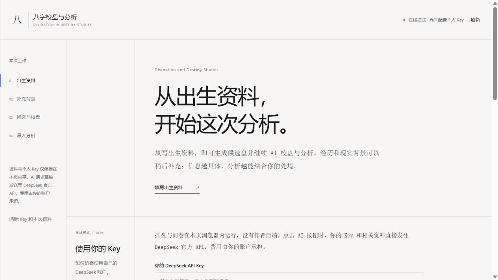

# Divination and Destiny Studies

**BaZi readings that take your real life into account.**

[**Try it online →**](https://www.theodoreoy.com/Divination-and-Destiny-Studies/) · [What you get](#what-you-get)

Similar birth charts can belong to people with very different families, opportunities, careers, and pressures. Divination and Destiny Studies brings personal context into BaZi (Four Pillars of Destiny), so a reading can address your circumstances: the resources you have, the constraints you face, and the directions you want to explore.

Start with your birth details. Every background question is optional. You can get a chart-based reading first, or add significant experiences to make the analysis more relevant to your life. Missing information stays unknown; you do not have to complete a questionnaire to receive a report.

## Unsure of your birth time? You can still start.

Use an exact time, a same-day range, or an unknown time. The app calculates the eligible charts, then compares supporting clues, contradictions, and open questions. When the evidence is limited, it provides a provisional working chart and a conditional reading while keeping alternatives visible.

## What you get

- **Candidate comparisons.** See the Four Pillars for each eligible birth time and the reasons for the provisional selection.
- **Personal analysis.** Explore education, career, relationships, resources, and possible actions, with chart interpretations distinguished from the facts you supplied.
- **A report to keep.** Download the reading with its supporting references, disagreements, and unknowns for later review.

For people who want to explore BaZi, reflect on past experiences, or consider traditional interpretations alongside present choices. Each report is a starting point for reflection, with provisional judgments clearly identified.

## Bring your own DeepSeek key

The online app runs in your browser. Add your own DeepSeek API key; an explicit AI action sends a request directly to the official API. Requests do not pass through an author-operated backend. Usage is billed to your DeepSeek account.

Your key stays in the current page's memory and is cleared on refresh, explicit clearing, or page departure. It is never written to browser storage or exported reports. A normal workflow makes two model requests: candidate comparison, then analysis. Repeating the same successful operation within a valid session reuses its result. Failed requests are never retried automatically.

The current interface and generated reports are in Simplified Chinese. Repository documentation is in English.

Birth-time identification and future prediction accuracy have not been established. A candidate's rank is not a calibrated probability. See the [validation record](docs/VALIDATION.md) for engineering checks and synthetic examples.

[Usage and local setup](docs/GETTING_STARTED.md) · [How it works](docs/ARCHITECTURE.md) · [API reference](docs/API.md) · [Calendar engine](docs/ZHENYI_INTEGRATION.md) · [Third-party notices](THIRD_PARTY_NOTICES.md)

Released under the [MIT License](LICENSE). Third-party files retain their original licenses and source records.
