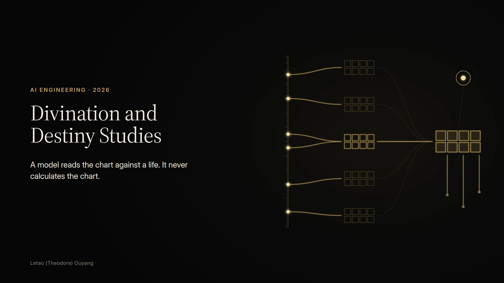
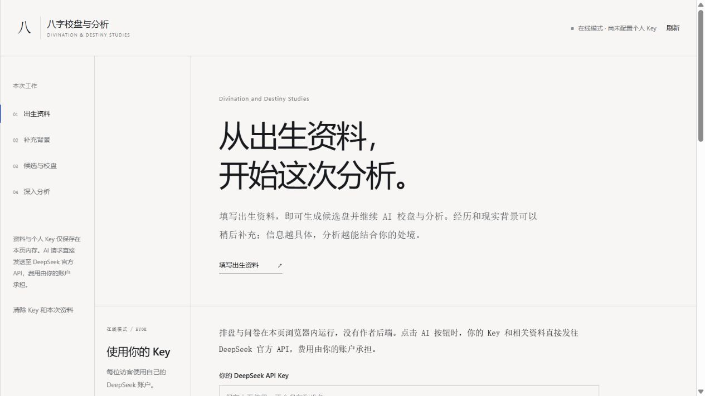
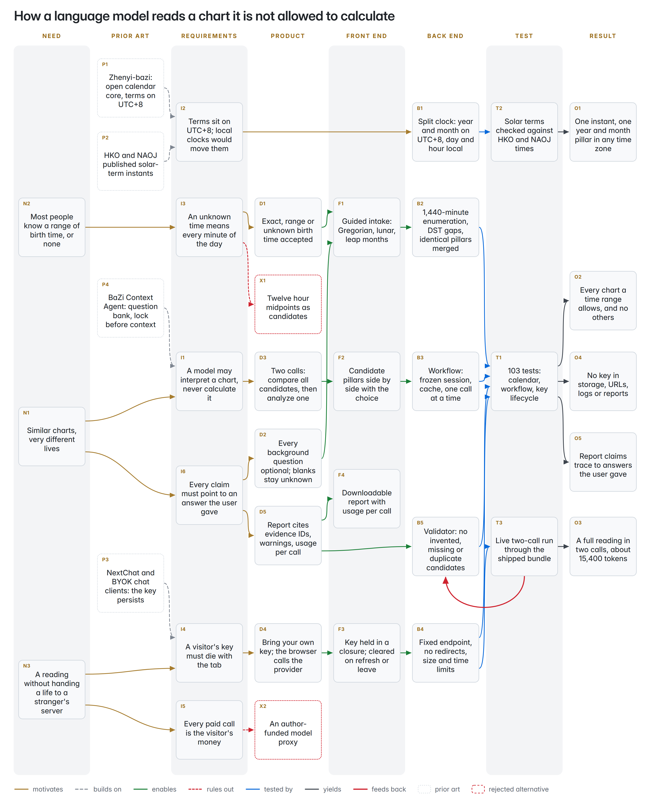

# Divination and Destiny Studies

**Letao (Theodore) Ouyang** · Product, front end, back end and tests · October 2026

[Open the app](https://www.theodoreoy.com/ENGINEERING-Divination-and-Destiny-Studies/) · [Engineering route](docs/engineering-route.md) · [Prior art](docs/prior-art.md) · [Architecture](docs/ARCHITECTURE.md) · [Calendar engine](docs/ZHENYI_INTEGRATION.md)

**Can a language model read a person's chart against their life without ever calculating the chart, seeing a server, or spending anyone's money but theirs?**

Similar birth charts belong to very different lives, and most people know their birth time only as a range, or not
at all. I built a BaZi reading app that takes both seriously. A local calendar engine computes every chart the birth
time allows, minute by minute; a language model compares those charts against the life events the person chooses to
share, recommends a working chart, and then reads it in the context of that life. The model interprets and never
calculates, every claim in the report points to an answer the person gave, and the whole app runs in the browser on
the visitor's own DeepSeek key, which lives in one closure and dies with the tab. A full reading takes **two calls and
about 15,400 tokens**, and **103 tests** hold the calendar, the workflow and the key lifecycle to their rules.

## Three results to start with

| Result | Why it matters | Where |
| --- | --- | --- |
| One instant gives the same year and month pillars in every time zone, checked two minutes either side of the solar-term minutes published by the Hong Kong Observatory and the National Astronomical Observatory of Japan | The upstream calendar places solar terms on UTC+8; read against a local clock, a boundary that happens once worldwide would move | [Calendar wrapper](src/chartEngine.ts) · [calendar notes](docs/ZHENYI_INTEGRATION.md) |
| An unknown birth time becomes every distinct chart of the day: all 1,440 minutes walked, skipped and repeated clock times handled, identical pillars merged | Twelve hour midpoints miss the charts that exist only near a boundary | [Calendar wrapper](src/chartEngine.ts) · [tests](tests/chartEngine.test.ts) |
| The visitor's key never touches storage, a URL, a log or a report, and no paid request is retried automatically | The visitor pays for every call and owns every answer | [Browser adapter](src/browser.ts) · [tests](tests/keyLifecycle.test.ts) |

## The problem

A BaZi reading is a chart read against a life. Two people with the same chart can have different families,
opportunities, careers and pressures, and a reading that ignores them reads the chart and misses the person. A
language model is good at exactly this kind of weighing. It is bad at calendar arithmetic, it will invent a life
detail when it has none, and an AI web app normally needs a backend that receives every visitor's history and bills
one account for everyone.

So four things had to hold at once: exact charts for any birth time, a model that interprets without calculating,
claims that cite real answers, and no server and no shared bill. [Prior art](docs/prior-art.md) sets out the open
calendar code, the observatory tables and the bring-your-own-key clients this design builds on.

## The hard part

**The calendar's own clock.** The open calendar core I build on, Zhenyi-bazi, adds one third of a day to every
solar-term date, which places its table on a fixed UTC+8 clock, and its entry point reads the whole chart from one
wall clock. I kept its five files byte for byte and wrapped them in a split clock: year and month pillars compare the
absolute instant on the UTC+8 timeline, day and hour pillars use the chosen local civil or true-solar clock. Longitude
and true solar time move the day and hour; they never move a solar term.

**Uncertain time.** An unknown time is walked minute by minute across the day. A nonexistent clock time is skipped
and reported, never shifted; a repeated one keeps both instants; and minutes merge only when all four pillars match.

**A model on a short leash.** The first call sees every candidate and the comparison evidence and must return every
candidate; the second analyzes the chosen chart and cannot switch charts. Output is validated against the candidate
set and the evidence IDs before anything reaches the report.

**Money and keys.** The client calls one fixed HTTPS endpoint, refuses redirects, caps responses at 1 MiB and 120
seconds, accepts only a complete JSON answer with usage counts, and never retries a paid request. Successful results
are cached, duplicate operations are blocked, and one call runs at a time.

## The design

| Layer | What I built | What it buys |
| --- | --- | --- |
| Product | Exact, range or unknown birth time in Gregorian or lunar dates; all 27 background questions optional, blanks kept as unknown; two calls, compare then analyze; a downloadable report with evidence IDs, warnings and usage per call | A reading from birth details alone at once, more personal with every answer added |
| Front end | A guided intake with leap months, time zone and longitude; candidate pillars side by side with the model's choice and the alternatives; the key held in a closure and erased on refresh, leaving or clearing; a strict content security policy that allows only the official endpoint | No account, no backend, nothing left behind |
| Back end | The split-clock calendar over five vendored files pinned by SHA-256; a workflow that freezes each session with its evaluation date, caches, serializes calls and expires sessions after 30 minutes; a JSON client with fixed limits; a validator for candidate identity and citations; the same workflow served by a local Node server | Exact charts, bounded calls, checkable claims, in the browser and on a local server alike |
| Tests | 103 tests with strict types over calendar fixtures, lunar conversion, DST gaps, the questionnaire, caching, concurrency, expiry, provider errors and the key lifecycle; observatory solar-term fixtures; a live two-call run through the shipped bundle | Every rule above holds on every change |

## What is new

1. **A split clock.** Solar terms keep their instant in every time zone, while day and hour follow the local or
   true-solar clock, without editing a byte of the upstream calendar.
2. **Complete candidate sets.** Exact, range and unknown birth times become every distinct chart at one-minute
   resolution.
3. **A model that interprets and never calculates.** Two calls over frozen data, with candidate identity enforced.
4. **Claims that cite answers.** Evidence IDs, warnings and usage in every report; a blank is never a fact.
5. **A key that dies with the tab.** Bring-your-own-key with no persistence, no proxy and no automatic retry.

The sibling project [BaZi Context Agent](https://github.com/130U/ENGINEERING-BaZi-Context-Agent) takes the opposite
design position and keeps every model off the ranking; this one lets the model compare candidates under strict
evidence rules.

## How it was built

<picture>
  <source media="(prefers-color-scheme: dark)" srcset="assets/route-dark.png">
  
</picture>

The route runs from need to result, and one test went back and changed the design.

- **A calendar that keeps the solar term at its instant.** Reading the upstream code line by line found its UTC+8
  table; observatory times check the wrapper.
- **Every chart a birth time allows.** Minutes, not midpoints.
- **A model that interprets and never calculates.** Arithmetic and evidence are frozen before the model speaks.
- **Claims that point to answers.** A live run lost a whole analysis to one malformed citation; that result went back
  into the validator, which repairs minor citation issues with a warning and fails only on candidate errors or
  missing text.
- **A key that dies with the tab.** The visitor's key, the visitor's bill, nothing stored.

The [engineering route](docs/engineering-route.md) explains all 37 steps and all 38 links.

## Repository

| Path | Contents |
| --- | --- |
| [`docs/engineering-route.md`](docs/engineering-route.md) · [`docs/prior-art.md`](docs/prior-art.md) | The route as a network, and the prior art |
| [`docs/ARCHITECTURE.md`](docs/ARCHITECTURE.md) · [`docs/API.md`](docs/API.md) · [`docs/ZHENYI_INTEGRATION.md`](docs/ZHENYI_INTEGRATION.md) · [`docs/QUESTIONNAIRE.md`](docs/QUESTIONNAIRE.md) · [`docs/DEEPSEEK.md`](docs/DEEPSEEK.md) · [`docs/VALIDATION.md`](docs/VALIDATION.md) | Architecture, operation contract, calendar, questionnaire, model client and validation |
| [`docs/GETTING_STARTED.md`](docs/GETTING_STARTED.md) | Using the app and running it locally |
| [`src/`](src/) | Calendar wrapper, questionnaire, workflow, prompts, result validation, DeepSeek client, browser adapter and local server |
| [`public/`](public/) | The interface shared by the browser app and the local server |
| [`vendor/zhenyi/`](vendor/zhenyi/) | Five unmodified upstream files and their source manifest |
| [`configs/`](configs/) | The question bank and runtime limits |
| [`tests/`](tests/) | The test suite |

## Citation

Letao (Theodore) Ouyang, *Divination and Destiny Studies* (2026),
<https://www.theodoreoy.com/ENGINEERING-Divination-and-Destiny-Studies/>. See [CITATION.cff](CITATION.cff).

[theodore.oy2025@gmail.com](mailto:theodore.oy2025@gmail.com) · [10@alumni.duke.edu](mailto:10@alumni.duke.edu)

© Letao (Theodore) Ouyang. Released under the [MIT license](LICENSE); vendored files keep their own license, listed in the [third-party notices](docs/THIRD_PARTY_NOTICES.md).
