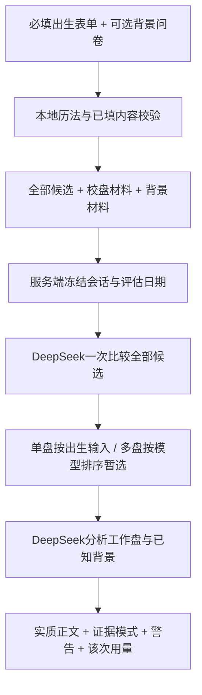

# 架构与证据边界

应用使用 Node 24 的原生 TypeScript 执行能力、内置 HTTP 服务和浏览器原生界面。没有应用运行时 npm 依赖；TypeScript 与 Node 类型声明用于开发检查。服务只监听本机，私人会话不写入文件或数据库。

## 数据流

问卷缺失值规范化、适用性与格式校验、日期转换和候选生成均在模型请求之前完成。出生资料必填，27 道问题和 2 道适用性确认全部可选；缺失记为 unknown，不补造事实。本地计算确定历法与数据格式；多候选的经历比较和工作盘建议由 LLM 完成，不使用隐藏的命理评分权重或预先淘汰候选。

## 模块职责

| 模块 | 职责 |
| --- | --- |
| `configs/question_bank.v1.json` | 问题、选项、适用条件、长度与数量限制、来源版本 |
| `src/questionnaire.ts` | 缺失值规范化、已填内容校验，生成带来源标签的 evidence / context |
| `src/chartEngine.ts` | 调用固定真一历法，处理公农历、时区、真太阳时及候选枚举 |
| `vendor/zhenyi/` | 5 份未修改的上游代码、数据和许可，以及本地来源清单 |
| `src/workflow.ts` | 会话、步骤顺序、结果缓存、并发控制、期限与清理 |
| `src/prompts.ts` | 分别构造候选比较和背景分析输入，控制单次输入预算 |
| `src/results.ts` | 验证必要正文与候选身份，规范化引用并生成报告警告 |
| `src/deepseek.ts` | 服务端凭据、固定接口、超时、响应大小、JSON 与用量读取 |
| `src/server.ts`、`public/` | 本机 HTTP API 与资料填写、结果展示 |

会话创建时保存独立冻结的数据副本和 `asOfDate`，模型输入使用 `as_of_date` 保留同一评估时间原点。后续请求只带会话 ID 与可选候选 ID，不能用客户端修改过的四柱或回答替换服务端快照。资料修正需新建会话。

## 两次模型调用

第一次只发送出生输入、全部候选、校盘材料及警告，候选须全部出现在结果里。单候选由出生输入直接成为 `provisional` 工作盘，`selection_source=birth_input`。多候选使用模型选择；未给出选择时，可采用完整模型排序首位并标记 `ranked_fallback`。证据不足仍继续暂定分析，明确低把握度、其他候选及待核对事项。未知状态和传统外貌等弱线索不能包装成已验证事实。

第二次发送选定工作盘、第一次结论、校盘材料和可选背景材料。没有已知个人材料时，提供基于命盘的实质条件性分析并标记 `chart_only`；有材料时标记 `context_supported`，结合实际背景解释。该标记表示输入可用性，不表示事实已经核实。工作盘必须来自本次候选；返回结果不能偷偷换盘。评估日期在两次调用间保持一致。

成功的校盘结果按会话缓存，成功的分析结果按会话及候选 ID 缓存。正在执行的重复操作会被阻止；当前服务全局最多一个模型调用。缓存只复用已有成功结果，不把未知、失败或超时伪装成成功。请求失败不会自动重试，显式重试可能再次计费。

## 历法口径与精度

上游固定提交为 `383a726437a81db2b87eed517ef5e6ccd30b7bd4`。wrapper 的完整规则标识为 `zhenyi-blind-00h-split-zi-absolute-jieqi-utc8-local-dayhour-v2-minute`：年/月在绝对时刻对应的固定 UTC+8 坐标上比较节气，日/时使用选定的当地民用时间或真太阳时间。这样时区或经度变化不会移动同一个全球节气瞬间。

时间未知时枚举全天 1,440 个民用分钟，处理 DST 缺口和重复解释，仅合并四柱完全相同的结果。相同四柱不保证精确交运时刻相同：起运与大运使用该组第一个有效分钟的代表计算，多分钟组明确警告，不能直接作逐日事件断点依据。底层历法支持范围比产品出生表单更广；产品按转换后的公历限定 1900 年至评估当天。详细口径与未完成验证见 [历法集成说明](ZHENYI_INTEGRATION.md)。

## 结构检查与预测有效性

每条回答保留题目 ID、原文、回复、阶段、用途，以及 `source: user_report`、`independentlyVerified: false`。`informationStatus: known` 仅表示有实质回复，不表示事实已独立核实。用于选择工作盘的经历，不能随后当成独立预测命中。

模型输出校验拒绝伪造、遗漏或重复候选、选择身份不一致及缺少必要正文。引用元数据的轻微问题会修复或移除，并通过 `reportWarnings` 展示，保留已有正文；未知回答不能因这种修复变成事实。分析输入的 `chart_reference_paths` 从实际工作盘生成，没有引用或未知项说明时会警告。引用存在并不证明模型理解正确；自然语言解释、因果关系和预测效果仍未得到语义或统计验证。模型自信、相对名次和规则值都不转换成真实时辰概率。

完整模型响应在业务校验失败时，错误保留安全的 `modelAttempt` 模型标签、耗时和用量，不返回原始正文。不会自动发起付费重试。页面和导出的 usage 只描述该次模型调用，不含另一阶段或此前失败、重试；缓存展示原请求用量，不能再次计费。未取得用量的失败也可能已产生费用。

离线测试验证输入边界、候选覆盖、日期口径、会话隔离、缓存与错误处理。真实 API 合成验收验证服务连接和端到端契约。两者都不替代隐藏可靠出生时辰的独立评估或预先定义的未来结果检验。

## 数据保存与服务边界

会话从创建起 30 分钟过期，独立定时器负责到期清理；手动删除、服务关闭或重启也会清空。定时器不单独阻止进程退出，正在请求的已删除会话不会保存迟到结果。这个期限不延长到最后一次操作。删除本地资料不意味着撤回提供方已经收到的内容。

API key 仅在服务端环境中读取；本地 `.env`、日志、私人资料目录和报告目录由 Git 忽略。公开源码不携带作者密钥，克隆者自行运行时使用各自配置的 key；如果开放同一个后端给别人，请求会消耗运营者 key 对应的额度。当前没有网页访客各自填写 key 的功能。HTTP 层限制请求大小、来源和内容类型，静态文件采用白名单，返回时隐藏凭据及提供方原始错误。生产代码没有离线模拟报告回退；受控假客户端只在测试中注入。

本项目是本机单用户 MVP，不包含账户隔离、共享部署、支付或其他术数模块。旧 `bazi-context-agent` 仅是已获授权的题库设计来源，运行时不依赖其文件、服务或代码。
