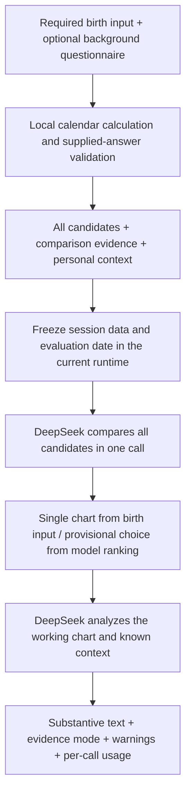

# Architecture and Evidence Boundaries

Version 0.3.0 shares chart calculation, questionnaire handling, the workflow, and the DeepSeek client across two modes. The static web app runs entirely in the browser, using each visitor's own key to call the official API directly. The local app uses Node 24's native TypeScript support and built-in HTTP server, with a key supplied through the operator's server environment. Both modes keep private sessions only in memory, without a database.

The browser build uses esbuild and a pinned version of `@noble/hashes` at runtime. Development checks use TypeScript and Node type declarations. The static site distributes only the page, application code, and licenses; it provides no model backend funded by the author's account. The local Node service continues to listen only on `127.0.0.1`.

## Data flow

Missing-answer normalization, applicability and format validation, date conversion, and candidate generation all finish before a model request. Birth details are required; all 27 questions and both applicability questions are optional. Missing answers become unknown, without invented facts. Local calculation determines calendar results and validates data formats. The LLM compares life events across multiple candidates and recommends a working chart. The system uses neither hidden divination scoring weights nor advance elimination of candidates.

## Module responsibilities

| Module | Responsibility |
| --- | --- |
| `configs/question_bank.v1.json` | Questions, options, applicability conditions, length and count limits, and source version |
| `src/questionnaire.ts` | Normalize missing answers, validate supplied content, and build source-labeled evidence and context |
| `src/chartEngine.ts` | Call the pinned Zhenyi calendar core; handle Gregorian/lunar dates, time zones, true solar time, and candidate enumeration |
| `vendor/zhenyi/` | Five unmodified upstream code, data, and license files, plus the local source manifest |
| `src/workflow.ts` | Sessions, operation order, result caching, concurrency control, expiration, and cleanup |
| `src/prompts.ts` | Build separate inputs for candidate comparison and contextual analysis; enforce per-call input budgets |
| `src/results.ts` | Validate essential text and candidate identity; normalize citations and produce report warnings |
| `src/deepseek.ts` | Accept credentials from the relevant environment; enforce the official endpoint, timeouts, and response-size limits; parse JSON and usage |
| `src/browser.ts` | Keep visitor keys in a closure; make direct requests; provide an in-memory operation adapter, clearing, and cancellation |
| `src/server.ts` | Local HTTP API, server-side credentials, and origin restrictions |
| `public/` | Shared data-entry and result-display interface for both modes |
| `scripts/build-web.ts` | Bundle the browser app and static assets; retain licenses without copying environment files or reports |

Session creation stores an independent, frozen data copy and `asOfDate`. Model inputs use `as_of_date` to preserve the same evaluation cutoff. Later operations carry only a session ID and an optional candidate ID; client-edited pillars or answers cannot replace the workflow snapshot. Data corrections require a new session. The browser adapter's `/api/...` names dispatch in-memory operations and do not make those HTTP requests to the static site. Only Node mode exposes the corresponding HTTP endpoints.

## Two model calls

The first call sends only the birth input, every candidate, chart-comparison evidence, and warnings. Every candidate must appear in the result. A single candidate becomes the `provisional` working chart directly from the birth input, with `selection_source=birth_input`. With multiple candidates, the model selects a chart. If it omits a selection, the first entry in a complete model ranking may be used as `ranked_fallback`. Limited evidence still permits provisional analysis, with explicit uncertainty, alternatives, and unresolved questions. Unknown answers and weak traditional clues, such as appearance, must not be presented as verified facts.

The second call sends the selected working chart, the first-stage conclusion, chart-comparison evidence, and optional personal context. With no known personal information, it provides substantive conditional analysis based on the chart and marks the result `chart_only`. Otherwise, it uses `context_supported` and interprets the chart alongside the supplied background. This label describes available input, not verified facts. The working chart must belong to the current candidate set, and the response cannot silently switch charts. Both calls use the same evaluation date.

Successful reviews are cached by session; successful analyses are cached by session and candidate ID. Duplicate operations already in progress are blocked. Each workflow instance permits at most one model call at a time, and browser tabs have separate instances. Caching reuses successful results only; unknown states, failures, and timeouts are not presented as successes. Failed requests are never retried automatically. An explicit retry may incur another charge.

## Calendar conventions and precision

The pinned upstream commit is `383a726437a81db2b87eed517ef5e6ccd30b7bd4`. The wrapper's full rule identifier is `zhenyi-blind-00h-split-zi-absolute-jieqi-utc8-local-dayhour-v2-minute`. Year and month pillars compare solar-term boundaries on a fixed UTC+8 timeline representing the absolute instant. Day and hour pillars use the selected local civil time or true solar time. Changing the time zone or longitude therefore does not move the same global solar-term instant.

When the birth time is unknown, the engine enumerates all 1,440 civil minutes of the day, handles DST gaps and repeated-time interpretations, and merges only results with identical Four Pillars. Identical pillars do not guarantee identical exact luck-cycle transition times. The initial transition and later luck cycles use a representative calculation for the group's first valid minute. Groups spanning multiple minutes carry an explicit warning and cannot directly serve as daily event breakpoints. The underlying calendar supports a wider date range than the product's birth form, which limits converted Gregorian dates to 1900 through the evaluation date. See the [calendar integration notes](ZHENYI_INTEGRATION.md) for detailed conventions and outstanding validation.

## Structural validation and predictive validity

Each answer retains its question ID, original question text, response, stage, purpose, `source: user_report`, and `independentlyVerified: false`. `informationStatus: known` means only that a substantive answer exists; it does not mean the facts were independently verified. Events used to select a working chart cannot later count as independent predictive hits.

Output validation rejects invented, omitted, or duplicate candidates, inconsistent selection identity, and missing essential report text. Minor citation-metadata issues are repaired or removed and disclosed through `reportWarnings`, while existing report text is preserved. Such repairs do not turn unknown answers into facts. The analysis input's `chart_reference_paths` are generated from the actual working chart; missing citations or uncertainty explanations produce warnings. A valid reference does not prove that the model understood it correctly. Natural-language explanations, causal claims, and predictive performance remain unverified semantically and statistically. Model confidence, relative rankings, and rule values are never converted into probabilities of the true birth hour.

When a complete model response fails business validation, the error retains safe model labels, duration, and usage in `modelAttempt`, without returning the raw text. It does not trigger an automatic paid retry. Usage shown on the page or in exports describes only that model call, excluding the other stage and earlier failures or retries. Cached results show the original request's usage; that usage must not be counted as a new charge. Failures without returned usage may still have incurred charges.

Offline tests check input boundaries, candidate coverage, date conventions, session isolation, caching, and error handling. Synthetic checks against the real API test connectivity and the end-to-end contract. Neither replaces an independent evaluation with reliable birth times withheld from the system or a test against predefined future outcomes.

## Data retention and service boundaries

Sessions expire 30 minutes after creation, with individual timers responsible for cleanup. Manual deletion also clears them. Closing or restarting the Node service loses its sessions. In the web app, refreshing or leaving the page, or replacing or clearing the key, clears the key and sessions. Cleared sessions do not retain late responses, and clearing cancels local pending requests. The deadline does not extend with each operation. Clearing data does not withdraw content already received by DeepSeek or cancel charges.

Online keys exist only in the current tab's closure memory. They are never written to localStorage, sessionStorage, URLs, logs, or exported reports. Setting a key does not call a model. An explicit AI action sends it in the authentication header directly to the official DeepSeek API, without an author-operated backend; charges belong to the visitor's account. The fixed endpoint, HTTPS requirement, static-page connection policy, and prohibition on following redirects constrain the credential's destination. They do not guarantee an absolutely secure browser environment.

Node mode reads its key from the server environment. Local `.env` files, logs, private-data directories, and report directories are ignored by Git. If the same Node backend is separately made available to others, their requests consume the operator's key allowance. The Node HTTP layer restricts request size, origin, and content type; serves static files from an allowlist; and hides credentials and raw provider errors in responses. Neither mode falls back to simulated offline reports. Controlled fake clients are injected only in tests.

The project provides static online BYOK and local execution. It does not include site accounts, hosted shared sessions, payments, or other divination systems. Per-tab memory isolation is not a multi-tenant backend account system. The old `bazi-context-agent` is only an authorized source of questionnaire design; runtime execution does not depend on its files, services, or code. Historical local checks, current public deployment checks, and direct-browser validation are recorded separately and cannot substitute for one another.
