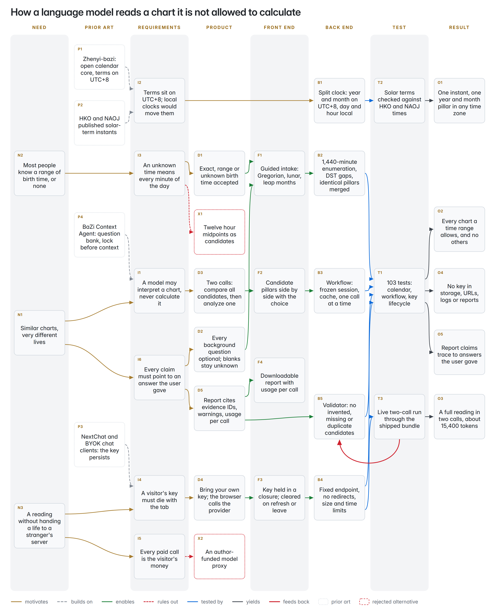

# Engineering route

How the product was built, from the need to the result: which need forced which requirement, what prior work each
decision stands on, how product, front end and back end divide the work, what the tests check, and where a test
went back and changed the design.

<picture>
  <source media="(prefers-color-scheme: dark)" srcset="../assets/route-dark.png">
  
</picture>

## Reading the figure

Columns run from need to result, the order in which a product is reasoned about. A link can run between any two
columns, and one runs backwards, from a test to the design.

| Link | Meaning |
| --- | --- |
| motivates | A need or a requirement that made the next step necessary |
| builds on | Prior work the step starts from |
| enables | A decision that makes a component possible |
| tested by / yields | A component and the suite that checks it; a suite and what it establishes |
| feeds back | A test result that changed the design |
| rules out | A requirement that excludes an alternative |

Solid boxes are my own steps. Dotted boxes are prior art, and red dashed boxes are alternatives I rejected.

## The five threads

### 1. A calendar that keeps the solar term at its instant

P1, P2 → I2 → B1 → T2 → O1.

The chart engine is Zhenyi-bazi's open calendar core (P1), vendored byte for byte and pinned to one commit. Reading
it line by line turned up its coordinate system: every solar-term date carries an added third of a day, which places
the table on a fixed UTC+8 clock (I2). Compared with a New York wall clock, or with true solar time, that table would
move a boundary that occurs at one instant worldwide. The wrapper therefore runs a split clock (B1). Year and month
pillars compare the absolute instant on the UTC+8 timeline; day and hour pillars use the chosen local civil or
true-solar clock. The check comes from outside any library (P2): instants two minutes either side of the Hong Kong
Observatory and National Astronomical Observatory of Japan minutes for Lichun and Jingzhe (T2). One instant gives the
same year and month pillars in every time zone (O1).

### 2. Every chart a birth time allows

N2 → I3 → D1 → F1 → B2 → T1 → O2, with I3 ruling out X1.

Most people know a range of birth time, or none (N2), so an unknown time is the main case. The common shortcut,
twelve two-hour midpoints (X1), misses charts that exist only near a boundary: late Zi, a solar term, a true-solar
date change. An unknown time means every minute of the day (I3). The form accepts an exact minute, a same-day range
or no time at all, in Gregorian or lunar dates with leap months, with time zone, longitude and true solar time stated
(D1, F1). The engine walks all 1,440 civil minutes, handles skipped and repeated clock times without moving them,
and merges only minutes whose four pillars match exactly (B2). The candidate set is complete at one-minute
resolution and contains no duplicates (O2).

### 3. A model that interprets and never calculates

N1, P4 → I1 → D3 → F2 → B3 → T1.

Similar charts belong to very different lives (N1), and weighing a life against several candidate charts is
interpretation, which a language model does well and code does not (I1). Calendar arithmetic has one right answer,
and a model has no part in it. The sibling project, BaZi Context Agent (P4), fixed the chart before reading the
present; here the model is allowed to compare candidates, so the arithmetic and the evidence are frozen before it
speaks. The workflow makes two calls (D3): the first sees every candidate and the comparison evidence and recommends
a working chart, the second analyzes that chart with the person's context, and both share one evaluation date. A
session freezes its data, caches successful results, blocks duplicate operations and runs one model call at a time
(B3).

### 4. Claims that point to answers

N1 → I6 → D2, D5 → F4, B5 → T1 → O5, with T3 feeding back into B5.

A reading that invents a sibling or a career move is fiction (I6). Every background question is optional and a
blank stays unknown (D2); the report cites evidence IDs, keeps warnings and shows each call's usage (D5, F4). The
validator rejects invented, missing or duplicate candidates and missing essential text (B5). A live run through the
shipped bundle set its final shape (T3 → B5): the first validator discarded an entire analysis over one malformed
citation, so minor citation issues are repaired and reported as warnings, while candidate errors and missing text
still fail the call. Report claims trace to answers the user gave (O5).

### 5. A key that dies with the tab

N3, P3 → I4 → D4 → F3 → B4 → T1, T3 → O4, O3; I5 rules out X2.

Visitors want a reading without handing their life to a stranger's server (N3). Bring-your-own-key chat clients
such as NextChat prove the model (P3), and they persist the key in browser storage, which outlives the visit. Here
the key must die with the tab (I4). The browser calls the official endpoint directly with the visitor's key (D4),
held in one closure and erased on refresh, on leaving, or on clearing (F3). The client calls one fixed HTTPS
endpoint, refuses redirects, caps responses at 1 MiB and 120 seconds, accepts only a complete JSON answer and never
retries a paid request (B4), because every call is the visitor's money (I5). An author-funded proxy (X2) would route
every life through a server and every visitor's usage through one account. The key never reaches storage, a URL, a
log or a report (O4), and a full reading takes two calls and about 15,400 tokens (O3).

## Every step

| Node | Column | What it is |
| --- | --- | --- |
| **N2** Most people know a range of birth time, or none | Need | A birth time is often remembered as "early morning" or not at all. A product that demands an exact minute turns most people away at the first field. |
| **N1** Similar charts, very different lives | Need | Family, opportunity, career and pressure differ between people who share a chart. A reading that ignores them reads the chart and misses the person. |
| **N3** A reading without handing a life to a stranger's server | Need | Birth data and life history are personal, and a free product run on the author's model account invites cost and abuse. Visitors need a reading that neither stores their life nor spends someone else's money. |
| **P1** Zhenyi-bazi: open calendar core, terms on UTC+8 | Prior Art | An MIT-licensed BaZi charting system with a complete local calendar: solar terms, four pillars, hidden stems, Ten Gods, Na Yin and luck cycles. Its solar-term table is placed on a fixed UTC+8 clock. |
| **P2** HKO and NAOJ published solar-term instants | Prior Art | The Hong Kong Observatory and the National Astronomical Observatory of Japan publish the minute of each solar term, a reference that no charting library produced. |
| **P4** BaZi Context Agent: question bank, lock before context | Prior Art | The sibling project: a 27-question bank in three groups and the rule that a working chart is fixed before personal context is read. |
| **P3** NextChat and BYOK chat clients: the key persists | Prior Art | Open-source bring-your-own-key chat clients let visitors use their own model accounts. NextChat persists the key in browser storage so it survives a reload. |
| **I2** Terms sit on UTC+8; local clocks would move them | Requirements | The upstream calendar adds one third of a day to every solar-term date, placing the table on UTC+8. Comparing it with New York wall time, or with true solar time, would shift a boundary that occurs at one instant worldwide. |
| **I3** An unknown time means every minute of the day | Requirements | Midpoints of the twelve two-hour periods miss charts that exist only near a boundary: late Zi, a solar term, a true-solar date change. Coverage has to be minute by minute. |
| **I1** A model may interpret a chart, never calculate it | Requirements | Weighing life events against candidate charts is interpretation, and a language model is good at it. Calendar arithmetic has one right answer, and a model has no business producing it. |
| **I6** Every claim must point to an answer the user gave | Requirements | A reading that invents a sibling or a career move is fiction. What the report says about a life must cite the answer it came from, and a blank must stay unknown. |
| **I4** A visitor's key must die with the tab | Requirements | A key in browser storage outlives the visit and is readable by anything that later runs on the origin. The key should exist only as long as the page that uses it. |
| **I5** Every paid call is the visitor's money | Requirements | Model calls are billed to the visitor's account, so no call may be repeated, retried or wasted without the visitor asking for it. |
| **D1** Exact, range or unknown birth time accepted | Product | The form takes an exact minute, a same-day range or no time at all, in Gregorian or lunar dates with leap months, with time zone, longitude and true solar time stated explicitly. |
| **X1** Twelve hour midpoints as candidates | Product | The common shortcut for an unknown time. Rejected: it misses minute-level structure at every boundary. |
| **D3** Two calls: compare all candidates, then analyze one | Product | The first call sees every candidate and the comparison evidence and recommends a working chart; the second analyzes that chart with the person's context. Both share one evaluation date. |
| **D2** Every background question optional; blanks stay unknown | Product | Birth details are required; all 27 background questions are optional. A chart-only reading is available at once, and each added answer makes it more personal. |
| **D5** Report cites evidence IDs, warnings, usage per call | Product | The downloadable report keeps its supporting references, disagreements and unknowns, and shows the tokens each model call used. |
| **D4** Bring your own key; the browser calls the provider | Product | The visitor's browser calls the official DeepSeek endpoint directly with the visitor's key. There is no author-run backend in between. |
| **X2** An author-funded model proxy | Product | The usual way to ship an AI web app. Rejected: it puts every visitor's life history through a server and every visitor's usage on one account. |
| **F1** Guided intake: Gregorian, lunar, leap months | Front End | A step-by-step form for birth details and the optional questionnaire, with missing and not-applicable answers as first-class choices. |
| **F2** Candidate pillars side by side with the choice | Front End | Every eligible chart is shown with its four pillars, the reasons for the provisional selection and the alternatives kept in view. |
| **F4** Downloadable report with usage per call | Front End | The report separates chart interpretation from the facts the person supplied, lists warnings and records each call's usage. |
| **F3** Key held in a closure; cleared on refresh or leave | Front End | The key lives in one closure in the current tab. Replacing it, clearing it, refreshing or leaving the page erases the key and every session. |
| **B1** Split clock: year and month on UTC+8, day and hour local | Back End | Year and month pillars compare the absolute instant on the upstream's UTC+8 timeline; day and hour pillars use the chosen local civil or true-solar clock. The vendored files stay byte-for-byte unchanged. |
| **B2** 1,440-minute enumeration, DST gaps, identical pillars merged | Back End | For an unknown time the engine walks all 1,440 minutes, handles skipped and repeated clock times, and merges only minutes whose four pillars match exactly. |
| **B3** Workflow: frozen session, cache, one call at a time | Back End | A session freezes its data and evaluation date. Successful results are cached, duplicate operations are blocked, one model call runs at a time and sessions expire after 30 minutes. |
| **B5** Validator: no invented, missing or duplicate candidates | Back End | Model output is checked against the candidate set and the evidence IDs. Candidate errors and missing essential text fail the call; minor citation issues are repaired and reported as warnings. |
| **B4** Fixed endpoint, no redirects, size and time limits | Back End | The client calls one HTTPS endpoint, refuses redirects, caps responses at 1 MiB and 120 seconds, accepts only a complete JSON answer, and never retries a paid request. |
| **T2** Solar terms checked against HKO and NAOJ times | Test | Instants two minutes before and after the published Lichun and Jingzhe minutes check the year and month change, across time zones and under true-solar correction. |
| **T1** 103 tests: calendar, workflow, key lifecycle | Test | Strict types and 103 tests over calendar fixtures, lunar conversion, DST gaps, the questionnaire, candidate identity, citations, caching, concurrency, expiry, provider errors and the browser key lifecycle, plus an integrity check of every vendored file. |
| **T3** Live two-call run through the shipped bundle | Test | The built browser bundle runs against the real provider with the public site's origin, at most two requests and nothing sensitive recorded. |
| **O1** One instant, one year and month pillar in any time zone | Result | A solar term changes the pillars at the same instant everywhere; only the day and hour pillars follow the local clock. |
| **O2** Every chart a time range allows, and no others | Result | Candidate sets are complete at one-minute resolution and contain no duplicates. |
| **O4** No key in storage, URLs, logs or reports | Result | The key never touches local storage, session storage, a URL, a log, a build file or an export. |
| **O5** Report claims trace to answers the user gave | Result | Citations resolve to known answers; blanks are never cited as facts. |
| **O3** A full reading in two calls, about 15,400 tokens | Result | Candidate comparison used 6,143 tokens and analysis 9,256, with repeated operations served from cache. |

## Every link

| # | From | To | Link | Why |
| ---: | --- | --- | --- | --- |
| 1 | P1 | I2 | builds on | Reading the upstream calendar line by line found the UTC+8 offset in its solar-term dates |
| 2 | P2 | I2 | builds on | Published instants give a reference that no upstream function produced |
| 3 | N2 | I3 | motivates | If most people cannot give an exact minute, an unknown time is the main case |
| 4 | N1 | I1 | motivates | Reading a life against a chart is interpretation, which code cannot do |
| 5 | P4 | I1 | builds on | The sibling project fixed the chart before context; here the model compares candidates, so arithmetic and evidence must be fixed before it speaks |
| 6 | N1 | I6 | motivates | A personal reading is only as personal as the facts it actually uses |
| 7 | N3 | I4 | motivates | Nothing about the visit should outlive the visit |
| 8 | P3 | I4 | builds on | Bring-your-own-key clients prove the model; persisting the key is the part to change |
| 9 | N3 | I5 | motivates | The visitor pays, so the visitor decides every call |
| 10 | I2 | B1 | motivates | Separate clocks for the year-month and day-hour pillars keep the solar term at its true instant |
| 11 | I3 | D1 | motivates | Exact, range and unknown are three honest answers to one question |
| 12 | I3 | X1 | rules out | Midpoints miss charts that exist only near a boundary |
| 13 | I1 | D3 | motivates | The model sees computed charts and evidence, compares, then analyzes the chart it chose |
| 14 | I6 | D2 | motivates | A blank is recorded as unknown, never filled in |
| 15 | I6 | D5 | motivates | Every statement in the report carries the evidence it rests on |
| 16 | I4 | D4 | motivates | The key goes from the visitor's tab to the provider and nowhere else |
| 17 | I5 | X2 | rules out | A proxy spends one account on everyone and routes every life through a server |
| 18 | D1 | F1 | enables | The intake offers each mode with explicit time zone and longitude |
| 19 | D2 | F1 | enables | Every background question can be skipped or marked unknown |
| 20 | D3 | F2 | enables | The comparison is shown with every candidate in view |
| 21 | D5 | F4 | enables | The report keeps references, warnings and usage |
| 22 | D5 | B5 | enables | Evidence IDs make citations checkable |
| 23 | D4 | F3 | enables | The key lives only in the page that uses it |
| 24 | F1 | B2 | enables | The intake's time mode decides how many minutes are walked |
| 25 | F2 | B3 | enables | Each action is a workflow operation on a frozen session |
| 26 | F3 | B4 | enables | The key is handed to one fixed request and nothing else |
| 27 | B1 | T2 | tested by | Boundaries are checked against observatory times |
| 28 | B2 | T1 | tested by | All 1,440 minutes, DST gaps and repeated times |
| 29 | B3 | T1 | tested by | Caching, concurrency, expiry and isolation |
| 30 | B5 | T1 | tested by | Invented, missing and duplicate candidates are rejected |
| 31 | B4 | T1 | tested by | Request shape, limits, no retry, key lifecycle |
| 32 | B4 | T3 | tested by | The real endpoint, from the real bundle, under the site's origin |
| 33 | T2 | O1 | yields | The solar term holds its instant in every time zone |
| 34 | T1 | O2 | yields | Candidate sets are complete and unique |
| 35 | T1 | O4 | yields | The key never reaches storage or output |
| 36 | T1 | O5 | yields | Citations resolve to known answers |
| 37 | T3 | O3 | yields | Two calls make a full reading |
| 38 | T3 | B5 | feeds back | A live run lost a whole analysis to one malformed citation, so the validator repairs minor citation issues with a warning and fails only on candidate errors or missing text |
